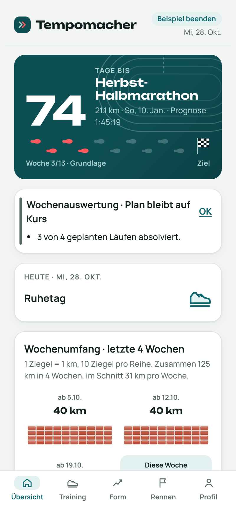
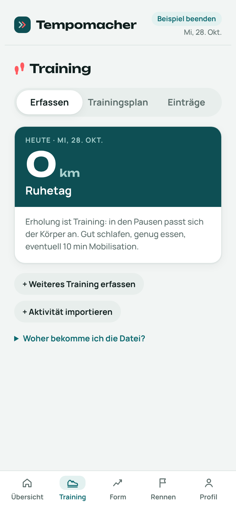
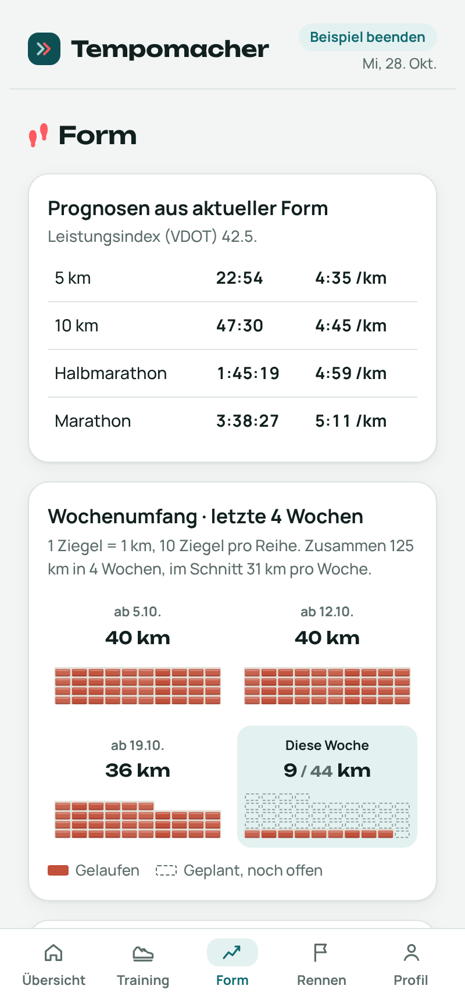
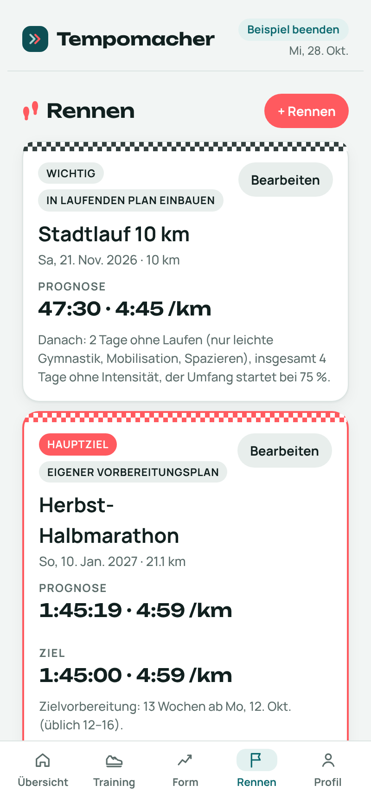
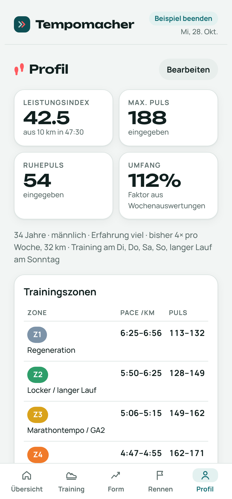

# Tempomacher

**Dein Lauf-Coach, der sich jede Woche an deine Form anpasst.**


Tempomacher erstellt einen persönlichen Trainingsplan für jedes Rennen bis 100 km. Der Plan richtet sich nach Alter, Lauferfahrung, aktueller Form und den Tagen, an denen du trainieren kannst. Er passt sich laufend an: an dein Befinden vor dem Training, an die erfassten Läufe und an deine Wochenbilanz.

Die App ist eine einzige Webseite ohne eigenen Server. Ohne weitere Einrichtung bleiben alle Daten im Browser des Geräts. Optional lässt sich ein Online-Speicher anbinden, damit dasselbe Profil auf Handy und Laptop funktioniert; die Daten werden dafür auf dem Gerät verschlüsselt.

| Übersicht | Training | Form | Rennen | Profil |
|---|---|---|---|---|
|  |  |  |  |  |

## Funktionen

- **Konten:** Benutzername und Passwort. Optional mit Online-Speicher, dann dasselbe Profil auf Handy und Laptop; die Daten werden dafür auf dem Gerät verschlüsselt (Einrichtung: [docs/CLOUD.md](docs/CLOUD.md)). Mehrere Personen können dasselbe Gerät nutzen.
- **Rennen, persönliches Ziel oder einfach fit:** Wer kein Rennen hat, setzt ein Ziel wie «10 km in 50 min» oder «5 km am Stück» (mit Zieltest am Ende) oder lässt sich mit einem Zeitbudget pro Woche fit machen und fit halten.
- **Trainingsplan bis 100 km:** Die Vorbereitungsdauer richtet sich nach der Distanz, z. B. 12–20 Wochen für einen Halbmarathon und 16–32 Wochen für einen Marathon; mit wenig Erfahrung eher an der oberen Grenze. Ist das Rennen weiter weg, gibt es vorher lockeres, abwechslungsreiches Training mit Alternativsport und Spasseinheiten.
- **Täglicher Check-in:** Bei Schmerzen oder schlechtem Gefühl wird die Einheit entschärft.
- **Training erfassen oder importieren:** Erfassen von Hand mit Laufart, Pace, Puls, Höhenmetern und Anstrengung, Import von FIT, GPX und TCX (auch die ZIP-Datei aus Garmin Connect) oder Import von Screenshots der Aktivität per Texterkennung. Intervalle werden automatisch erkannt.
- **Auswertung alle 2 Wochen:** Auf Basis von zwei Trainingswochen wird der Plan ambitionierter, bleibt gleich oder wird zurückgenommen. Bei starken Schmerzen oder Krankheit greift ein Zwischen-Check sofort.
- **Umfang nach Zielzeit:** Spitzenumfang und langer Lauf richten sich nach Zielzeit, Erfahrung, Trainingstagen und aktuellem Umfang, wie in gängigen Trainingsplänen (z. B. Marathon 3:15–3:30: 70–85 km pro Woche).
- **Trainingshäufigkeit:** Individuelle Empfehlung, wie viele Trainings pro Woche es für das Ziel braucht. Ist ein Ziel mit zu wenigen Trainings nicht seriös machbar (z. B. Marathon mit 1 Training pro Woche), lässt die App den Plan nicht zu.
- **Rennen:** Für jedes Rennen wählst du, wie wichtig es ist und ob es einen eigenen Plan bekommt. Nach jedem Rennen plant die App eine Pause ein, die zur Distanz passt.
- **Form:** Wochenumfang als Ziegelmauer, Effizienz-Index, Decoupling bei Long Runs, Bestzeiten-Verlauf, Trainingsbelastung und Leistungsindex.
- **Profil:** Puls- und Pacezonen, Werte aus Laktatstufentest oder Spiroergometrie, Bestleistungen.
- **Erinnerung am Vorabend:** Kalenderdatei (.ics) mit einer Meldung um 21:00 für die Einheit am nächsten Tag.
- **Deutsch und Englisch:** Umschalter DE | EN auf der Anmeldeseite und im Profil. Auf Englisch heisst die App «Pacemaker».
- **Installierbar:** Lässt sich auf dem Handy als App auf den Startbildschirm legen und funktioniert auch offline.

## Auf GitHub Pages veröffentlichen

1. Auf [github.com](https://github.com) ein neues, **öffentliches** Repository erstellen, z. B. `tempomacher`.
2. Alle Dateien aus diesem Ordner hochladen, entweder per «Add file → Upload files» im Browser oder mit Git:
   ```bash
   git init
   git add .
   git commit -m "Tempomacher veröffentlichen"
   git branch -M main
   git remote add origin https://github.com/DEIN-NAME/tempomacher.git
   git push -u origin main
   ```
3. Im Repository unter **Settings → Pages** bei «Build and deployment» die Quelle **Deploy from a branch** wählen, Branch **main**, Ordner **/ (root)**, dann speichern.
4. Nach ein bis zwei Minuten ist die App erreichbar unter `https://DEIN-NAME.github.io/tempomacher/`.
5. Optional: Unter **Settings → General → Social preview** das Bild `docs/bilder/social-preview.png` hochladen. Es erscheint dann, wenn der Link geteilt wird.

### Als App aufs Handy

- **iPhone (Safari):** Seite öffnen → Teilen → «Zum Home-Bildschirm».
- **Android (Chrome):** Seite öffnen → Menü ⋮ → «App installieren» bzw. «Zum Startbildschirm hinzufügen».

Auf dem Startbildschirm erscheint das Pfeil-Logo. Hast du die App schon früher hinzugefügt und siehst noch ein anderes Bild, entferne sie und füge sie neu hinzu: Handys übernehmen Icon und Namen nur beim Hinzufügen. Wer Englisch eingestellt hat, sieht dort den Namen «Pacemaker».

## Updates

Eine neue Version veröffentlichst du, indem du `index.html` im Repository ersetzt. GitHub Pages stellt sie nach kurzer Zeit bereit. Beim nächsten Öffnen mit Internetverbindung lädt die App die neue Version.

Die Daten der Nutzerinnen und Nutzer bleiben bei Updates erhalten, solange die Adresse gleich bleibt (`DEIN-NAME.github.io`). Wechselst du später auf eine eigene Domain, startet die App dort leer.

## Dateien

| Datei | Zweck |
|---|---|
| `index.html` | Die komplette App (Oberfläche, Trainingslogik, Import) |
| `manifest.webmanifest` | Name, Farben und Icons für die Installation aufs Handy |
| `manifest-en.webmanifest` | Dasselbe für die englische Version («Pacemaker») |
| `vendor/` | Texterkennung (Tesseract.js, Apache-2.0) und Sprachdaten Deutsch/Englisch; so lädt die Seite nichts von fremden Servern |
| `config.js` | Zugangsdaten für den optionalen Online-Speicher (leer = nur lokal) |
| `docs/CLOUD.md`, `docs/sql/` | Anleitung und SQL für «dasselbe Profil auf Handy und Laptop» |
| `sw.js` | Offline-Unterstützung; neue Versionen werden beim nächsten Besuch geladen |
| `icons/` | App-Icons (SVG und PNG, inkl. Apple-Touch-Icon und maskierbares Icon) |
| `.nojekyll` | Sorgt dafür, dass GitHub Pages die Dateien unverändert ausliefert |
| `docs/DESIGN.md` | Designsystem: Farben, Schriften, Komponenten, Grafiken |
| `docs/TRAININGSLOGIK.md` | Wie Plan, Anpassung, Effizienz und Decoupling berechnet werden |
| `docs/ANLEITUNG.md` | Bedienungsanleitung für Läuferinnen und Läufer |
| `docs/DATENSCHUTZ.md` | Datenschutzhinweis |
| `docs/bilder/` | Screenshots und Vorschaubild |
| `CHANGELOG.md` | Versionsverlauf |

## Hinweis

Tempomacher ersetzt keine medizinische Beratung. Bei anhaltenden Schmerzen oder Beschwerden ärztlich abklären lassen.

## Sicherheit

- Die Seite lädt keine Inhalte von fremden Servern; Schriften und Texterkennung sind Teil des Repositorys.
- Eine Content Security Policy erlaubt nur den eigenen, per Prüfsumme festgelegten Code und Verbindungen zur eigenen Seite und zu Supabase.
- Online-Profile sind Ende-zu-Ende verschlüsselt; Passwort-Raten wird nach 10 Fehlversuchen gesperrt.
- Wichtig für dich als Betreiber: Zwei-Faktor-Anmeldung bei GitHub und Supabase einschalten, niemandem Schreibrechte auf das Repository geben, den Secret key von Supabase nirgends eintragen.

Schriften: Unbounded und Manrope (SIL Open Font License). Texterkennung: Tesseract.js (Apache License 2.0).

---

© 2026 Ramon Betschart. Alle Rechte vorbehalten.
